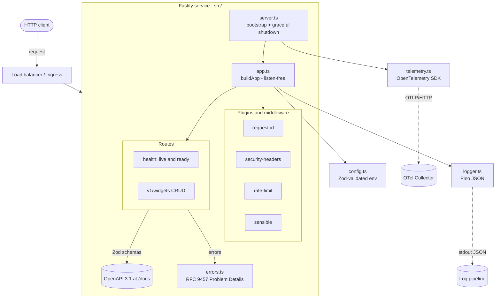
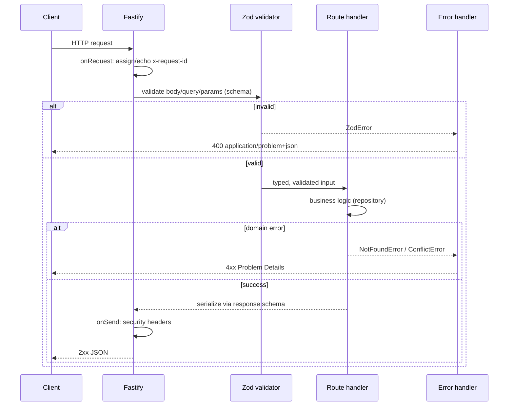
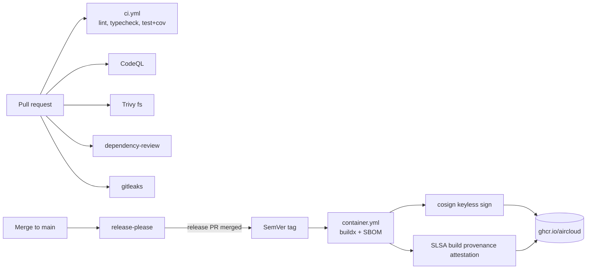

# Architecture

This document describes the runtime architecture, the request lifecycle, the
CI/CD supply chain, and operational runbooks.

## Overview

A single-process, stateless Fastify v5 HTTP service. State (if any) lives in
external systems; the example uses an in-memory repository you are expected to
replace. The service is designed to be horizontally scalable behind a load
balancer and orchestrated by Kubernetes (liveness/readiness probes included).

## Component diagram

## Request lifecycle

## Supply chain (CI/CD)

## Key design decisions

- **Schema-first**: Zod schemas are the single source of truth for validation,
  TypeScript types, and the OpenAPI document. No drift between code and docs.
- **`buildApp()` is listen-free** so integration tests run in-process via
  `app.inject()` — fast, deterministic, no port contention.
- **Fail-fast config**: invalid environment aborts boot. No partial startup.
- **Problem Details everywhere**: one consistent, machine-readable error shape.
- **Distroless + non-root + read-only-rootfs friendly**: minimal attack surface.
- **No long-lived secrets**: OIDC for cloud, keyless cosign for signing.

---

## Runbook: service is unhealthy / failing readiness

**Symptoms:** `/health/ready` returns 503, pods restarting, 5xx spike.

1. **Check liveness vs readiness.** `curl :3000/health/live` (process up) and
   `curl :3000/health/ready` (dependencies). Liveness failing => process/event
   loop issue; readiness failing => downstream dependency.
2. **Inspect logs by request id.** Logs are JSON; filter by `requestId` from the
   client's `x-request-id` header. Look for `level: error/fatal`.
3. **Check traces** in the OTel backend for slow/erroring spans (DB, upstream).
4. **Config drift?** A bad env var fails the boot with a clear message — check
   the container's startup logs for `Invalid environment configuration`.
5. **Rate limiting?** A flood of 429s with `x-ratelimit-*` headers indicates a
   client hammering the API; consider raising `RATE_LIMIT_MAX` or shedding load.
6. **Roll back** to the previous signed image tag if a recent deploy correlates
   with the incident: `kubectl rollout undo deploy/<svc>`. Verify the image
   signature first: `cosign verify ghcr.io/aircloud/<svc>:<tag> ...`.

## Runbook: cutting a release

1. Ensure `main` is green. Merge the open **release-please** PR.
2. That merge creates a SemVer tag; `container.yml` builds, generates an SBOM,
   signs the image (keyless cosign) and attaches SLSA provenance.
3. Verify: `cosign verify --certificate-identity-regexp '...' --certificate-oidc-issuer https://token.actions.githubusercontent.com ghcr.io/aircloud/template-backend-typescript:<tag>`.
4. Promote the tag through environments per your deployment pipeline.

## Runbook: rotating a leaked credential

Long-lived credentials are not used by design. If something is accidentally
committed: `gitleaks` (pre-commit + CI) should block it. If it lands anyway,
invalidate the credential at its source immediately, then purge history with
`git filter-repo` and force-rotate. Open a private security advisory per
`SECURITY.md`.
